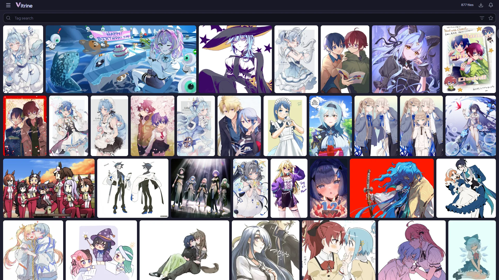
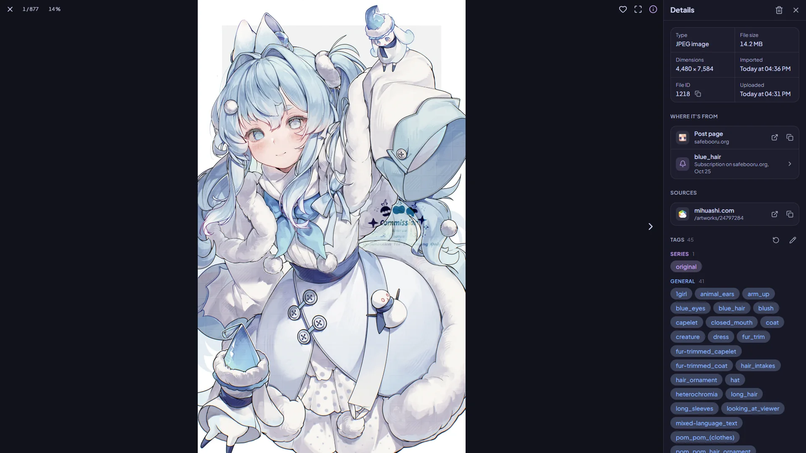
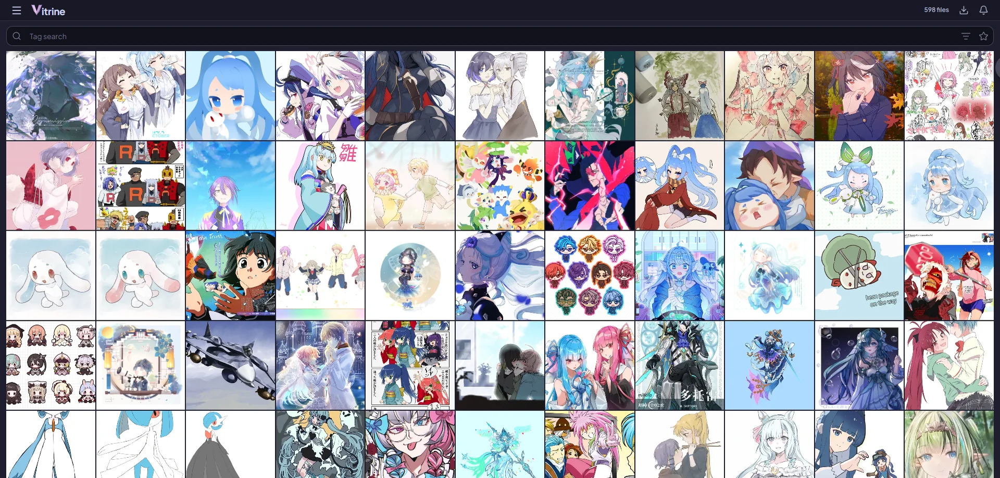
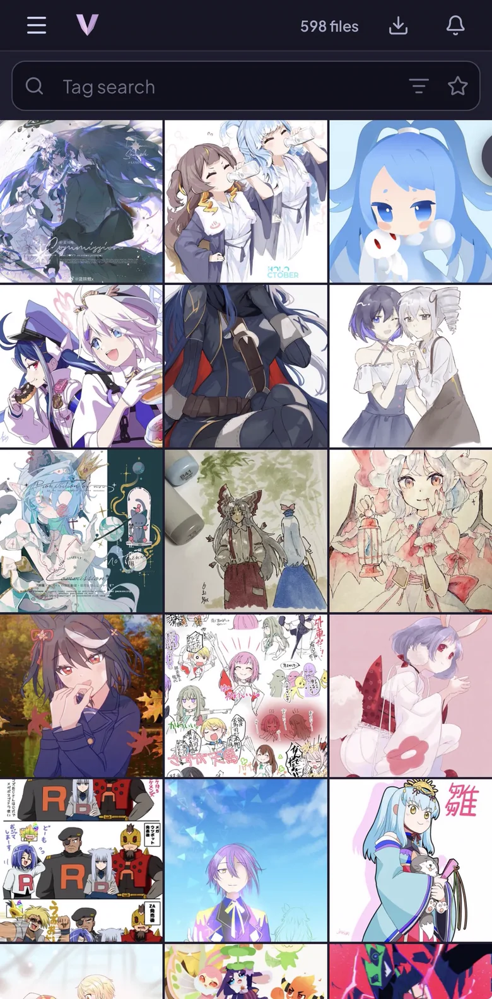
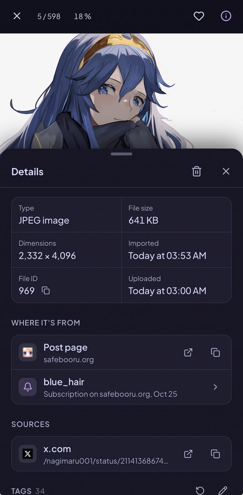

# Vitrine



A fast, self-hosted **media library with a built-in downloader and its own web app**, a lean alternative to
[Hydrus](https://github.com/hydrusnetwork/hydrus) for people who use their library through a browser - on a phone
as much as on a desktop.

One program stores your files, keeps their tags (with parents and siblings), searches them in milliseconds, makes
thumbnails, downloads from booru-style and gallery sites through plugins, and serves a phone-first web app you can
add to your home screen.

## What it does

- **Library**: pictures and videos (JPEG, PNG, GIF, WebP, AVIF, MP4, MOV, WebM, MKV), each stored once, with the
  tags and links of every site it came from. Favorites, view counts, an optional Rankings page of your top creators,
  characters and series, a trash with undo, duplicate detection with a side-by-side review, statistics.
- **Search**: booru-style - `tag -excluded ( a ~ b ) *wild* system:imported<5d system:type=video sort:size` - as
  editable chips, with autocomplete, tag parents and siblings, saved searches and many filters and orders. Searches
  take milliseconds even at a million files.
- **Downloader**: download a search once or subscribe to it; subscriptions check on their own and only bring what's
  new. Resumes exactly where it stopped, never downloads a file twice, respects each site's limits, blacklist and
  file rules, tag refresh of what you have. A site that stops answering pauses by itself and carries on when it's
  back. Sites come as plugins from a separate repository.
- **Comics**: galleries (e.g. from e-hentai) become comics with their own reader, collections, reading progress -
  and a Browse page with saved searches to look through a gallery site before downloading.
- **Web app**: one app for phone and desktop, installable (PWA), with its own video player, a viewer that swipes
  through results, bulk tag editing, push notifications, light on data. One account, with a password or passkeys.
- **Updates**: told when a new version is out and installed from the app, with a backup first. A fix for what's
  already in your library is explained first, yours to run or skip, and you follow it from the top bar.
- **Command line**: `vitrine status`, `queue`, `subs`, `logs` and more talk to the running server.

## Screenshots





<p align="center">
  
  
  
</p>

<sub>Pictures from safebooru.org, by their artists.</sub>

## Installing

### Docker (recommended)

Copy [`compose.example.yaml`](compose.example.yaml) to `compose.yaml`, adjust the two folders, then:

```sh
docker compose up -d
```

Open `http://<host>:8080` and create your account - the first visitor creates it, so do this before putting Vitrine
on the internet. The first steps then walk you through storage, sites, the app and notifications.

- `./data` holds the databases, thumbnails, plugins and site logins: put it on fast storage (an SSD).
- `./files` holds the original files: it can be a big, slow disk.
- Push notifications and installing the app on a phone need HTTPS: put Vitrine behind a reverse proxy (Caddy,
  Traefik, nginx...) with a certificate.
- Updates: Vitrine tells you when a new version is out (Settings > Updates, and the bell). With the
  example's Watchtower service, Update installs it from there; without it, `docker compose pull && docker compose
  up -d`.

### NixOS

Vitrine runs natively, with no containers: the repository is a flake with a package and a module. In your system's flake:

```nix
{
  inputs.nixpkgs.url = "github:NixOS/nixpkgs/nixos-unstable";
  inputs.vitrine.url = "github:usevitrine/vitrine/stable"; # the releases: main has what isn't released yet

  outputs = { nixpkgs, vitrine, ... }: {
    nixosConfigurations.myhost = nixpkgs.lib.nixosSystem {
      system = "x86_64-linux";
      modules = [
        vitrine.nixosModules.default
        ({ pkgs, lib, ... }: {
          services.vitrine = {
            enable = true;
            dataDir = "/var/lib/vitrine"; # the databases, thumbnails and plugins: fast storage (an SSD); this is the default
            filesDir = "/mnt/bulk/vitrine"; # the originals: can be a big, slow disk
            openFirewall = true;
          };

          # Decoding videos on the GPU (optional). Intel (pkgs.intel-vaapi-driver for chips before 2014):
          hardware.graphics.extraPackages = [ pkgs.intel-media-driver ];
          # AMD: nothing to add, Mesa has it. Nvidia, with its proprietary driver:
          # nixpkgs.config.allowUnfree = true;
          # services.xserver.videoDrivers = [ "nvidia" ];
          # hardware.nvidia.open = true; # false for cards older than the GTX 16 series

          # FlareSolverr (optional), for sites that show Cloudflare's "Checking your browser" page: then set
          # Settings > Sites > Cloudflare to http://localhost:8191 (Test says whether it answers). Its browser's
          # virtual display needs @setuid, which nixpkgs' unit denies - without this line no check ever passes.
          services.flaresolverr.enable = true;
          systemd.services.flaresolverr.serviceConfig.SystemCallFilter = lib.mkAfter [ "@setuid" ];
        })
      ];
    };
  };
}
```

- Vitrine brings its own tools from its own `nixpkgs` input. Don't make that follow a stable release: Vitrine needs a
  newer Go than those have.
- Updates, each with a backup of the library first. By hand: `nix flake update vitrine`, then `nixos-rebuild switch`.
  Or set `services.vitrine.updates.flake = "/etc/nixos"` (your flake's folder) and either or both of
  `updates.automatic.enable = true` (a timer, 04:00 by default) and `updates.button = true` (Update in Settings). Those
  move only Vitrine's input and rebuild the system from the flake as it stands, so with whatever else you've changed in it.
- Going back with `nixos-rebuild switch --rollback` works until a new version has changed the database: the older one
  then refuses it and says so. `vitrine restore /var/lib/vitrine/backups/<the backup from before the update>` brings it back.
- More options: [`nix/module.nix`](nix/module.nix). The `vitrine` command works as usual, as root too.

### Windows

Download `Vitrine-Setup-<version>-x64.exe` (`-arm64.exe` for Windows on ARM) from the
[latest release](https://github.com/usevitrine/vitrine/releases/latest) and run it - no administrator needed. It asks where to keep your library (the databases and thumbnails, the
original files, the backups: each can go on its own drive), the port, and whether phones on your Wi-Fi may open
Vitrine, and comes with ffmpeg and libvips. Vitrine then runs in the notification area (by the clock): click its
icon to open it in your browser; its menu has the address for your phone, your files, Start with Windows, Restart
and Quit. The `vitrine` command is on your `PATH` (optional), and Settings > Updates installs new versions. Windows
may warn that the installer is from an unknown publisher (it isn't code-signed): More info > Run anyway.

### Native

Download the binary for your system (Linux, macOS; amd64 and arm64 - on Windows, the installer above), put it on your `PATH`, and run:

```sh
vitrine serve        # web app at http://localhost:8080
vitrine config       # where the library lives, which tools were found
```

Install [ffmpeg](https://ffmpeg.org) for videos and thumbnails; [libvips](https://www.libvips.org) is optional
(faster for big images). Settings are described in [`config.example.toml`](config.example.toml).

**Portable** (e.g. a folder on Windows or a USB drive): put a `config.toml` next to the program with
`data_dir = "data"`. Vitrine then keeps everything in that folder (move or copy it, the library goes with it), a
double-click starts the server, and `ffmpeg`, `ffprobe` and `vipsthumbnail` placed beside it are used.

## Command line

While `vitrine serve` runs, the `vitrine` command talks to it through a local socket (no login; only this machine,
in Docker only the container):

```sh
vitrine status                                # library, queue, subscriptions, sites, notices
vitrine queue -w                              # the download queue, kept up to date
vitrine queue add safebooru blue_sky -max 50  # download a search
vitrine subs add safebooru blue_sky -every 1d # subscribe
vitrine failed retry all                      # try failed files again
vitrine logs -f                               # follow the log
docker exec vitrine vitrine status            # the same, in Docker
```

Every command is described in [docs/cli.md](docs/cli.md).

## Building

You need [Go](https://go.dev/dl/) 1.27 or newer and [Node.js](https://nodejs.org) 24 (for the web app).

```sh
cd web && npm ci && npm run build && cd ..   # the web app, embedded into the binary
go build ./cmd/vitrine
go test ./...
cd web && npx playwright install && npm run e2e   # the end-to-end tests (iPhone, Safari and Chrome engines)
```

Working on the web app: run `vitrine serve`, then `npm run dev` in `web/` (hot reload on http://localhost:5173).
How it's built and why: [docs/](docs/README.md). Contributing: [CONTRIBUTING.md](CONTRIBUTING.md).

## License

Copyright (C) 2026 The Vitrine authors.

Vitrine is licensed under the [GNU Affero General Public License v3.0 or later](LICENSE). If you run a modified
Vitrine for other people over a network, offer them its source code too (section 13). The licenses of the software
built into it are at `/licenses` in every Vitrine (and in [internal/server/licenses](internal/server/licenses)).
The site plugins live in [usevitrine/vitrine-plugins](https://github.com/usevitrine/vitrine-plugins).
